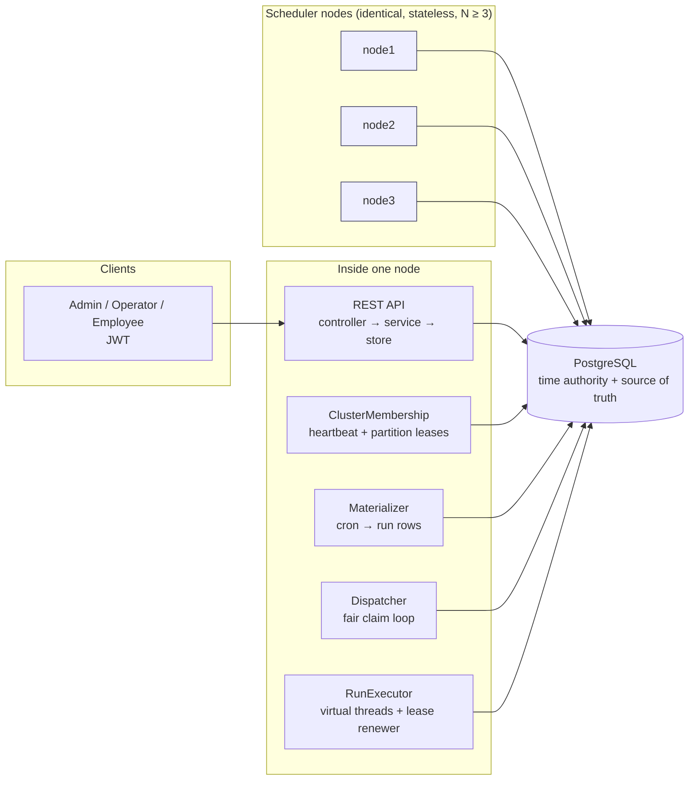

# Design note: Distributed Trip Job Scheduler

Case Study 3 — *exactly-once across a cluster*. Java 21 · Spring Boot 3.3 · PostgreSQL 16 · no other infrastructure.

## 1. What is guaranteed (and what is impossible)

**Exactly-once *execution* is impossible** in a system where a node can crash or freeze at any instruction: after the
handler returned but before the "done" write reaches the database, nobody (not even the node itself) can know whether
the work happened. Any scheme must either retry (maybe twice) or give up (maybe zero times).

We guarantee instead:

| Property | Mechanism |
|---|---|
| **At-least-once execution** — no job is lost | A run is leased, not removed. If the lease expires (crash, freeze, partition) another node re-leases it. |
| **Exactly-once effect** — nothing happens twice | The run's effects are written under a deterministic idempotency key (`tenant:job:scheduledAt#i`, `PRIMARY KEY`) **in the same transaction** as the fenced completion. |
| **Zombie safety** — a node that slept past its lease cannot commit | Every lease carries a fencing token (a global monotonic sequence). Every write presents `(run id, fence)` and re-checks, in the same SQL statement, that the lease is still alive on the DB clock. 0 rows updated ⇒ *you lost the lease*. |

For effects outside the database (an SMS gateway), the handler passes `ClaimedRun.idempotencyKey()` to the provider;
the same key arrives on every retry, so the provider deduplicates. The simulated handlers in this repo write the
effect to the `effect` table so the guarantee can be *asserted* by tests and scripts.

## 2. Architecture



* **PostgreSQL is the only coordination point** (no ZooKeeper / Redis needed). It already provides what the problem
  needs: a single serialisation order (`clock_timestamp()`, sequences), row locks with `SKIP LOCKED`, and atomic
  multi-statement transactions.
* **No single hot lock.** The global bottleneck of "every node fights over one lock row" is avoided in three layers:
  1. **Partitions** (64 by default, one `partition_lease` row each): a node only scans/materialises/claims in the
     partitions it owns, so nodes touch disjoint index ranges.
  2. **`FOR UPDATE SKIP LOCKED`**: even inside a partition, a locked row is skipped, never waited for.
  3. **Per-tenant advisory lock**, held only for the few milliseconds of a claim, so two nodes serialise *per tenant*
     (needed for an exact concurrency cap) and never across tenants.
* **Correctness never depends on partition ownership.** Partitions are a *performance* device. A node with a stale
  view only wastes work; leases + fencing still prevent duplicates. This is the key to making membership "eventually
  right" without consensus.

### Which clock decides?
**The database server's clock** (`clock_timestamp()`), for *everything*: when a run is due, when a lease expires, when
a node is considered dead, the fire-lag baseline. Node clocks are never compared with each other or with run times,
so clock skew between nodes cannot make a job fire early/late or make two nodes disagree about a lease. (Nodes use
`System.nanoTime()` — monotonic, immune to NTP steps — only to bound how long *they themselves* trust their own
partition ownership.) Trade-off: the DB is a single time source; if it is down nothing schedules (see §9).

## 3. Data model

```
tenant(id, time_zone, max_concurrency, paused)
job(id, tenant_id, type, cron|run_at, time_zone, payload, priority, max_run_seconds, max_attempts,
    misfire_policy, partition_id, next_fire_at, active)
job_run(id, job_id, tenant_id, partition_id, scheduled_at, run_at, status, attempts,
        fence, lease_owner, lease_expires_at, idempotency_key, …)       UNIQUE(job_id, scheduled_at)
effect(idempotency_key PK, tenant_id, run_id, kind, fence)
node(node_id, last_heartbeat)      partition_lease(partition_id PK, owner, epoch, expires_at)
```
Statuses: `PENDING → RUNNING → SUCCEEDED | DEAD | SKIPPED`, `RUNNING → PENDING` on retry, `DEAD → PENDING` on replay.
`job_run` rows carry a denormalised copy of type/payload/limits, so the hot claim path reads **one table, one index**.

Indexes are partial (`WHERE status='PENDING'`, `WHERE status='RUNNING'`) so finished history never slows the claim path.

## 4. The hardest flow: a node freezes and wakes up after its lease expired

```mermaid
sequenceDiagram
  autonumber
  participant A as Node A (will freeze)
  participant DB as PostgreSQL (clock + fence_seq)
  participant B as Node B
  A->>DB: CLAIM run 42 (lease 15 s)
  DB-->>A: fence = 100
  Note over A: handler running…<br/>— A is frozen (SIGSTOP / 30 s GC) —
  Note over DB: lease_expires_at < clock_timestamp()
  B->>DB: CLAIM (status=RUNNING AND lease expired)
  DB-->>B: run 42, fence = 107 (takeover)
  B->>DB: BEGIN; UPDATE … WHERE id=42 AND fence=107 AND lease alive → 1 row
  B->>DB: INSERT effect(key) ; COMMIT
  Note over A: A wakes up, handler returns
  A->>DB: UPDATE … WHERE id=42 AND fence=100 …
  DB-->>A: 0 rows → FENCED_OUT (no effect written, metric ++)
```
Both executions happened (at-least-once), only B's effect exists (exactly-once effect). The same statement that
checks the fence also checks `lease_expires_at > clock_timestamp()`, so a zombie is rejected even if nobody has
taken the run over yet — it just gets re-run later.

*Proven by*: `ClusterGuaranteesTest.staleLeaseHolderCannotCommit…` (deterministic, store level),
`frozenNodeWakesUpAfterItsLeaseExpired…` (whole node), and `scripts/chaos-freeze.sh` (`docker pause`, real JVMs).

## 5. Partitioning and rebalancing

* `partition = hash(jobId) mod P` (P fixed at 64; it must exceed the node count you will ever run and is a
  deployment constant).
* Every node computes *the same* desired owner per partition with **rendezvous hashing** over the set of live nodes
  (heartbeat younger than `node-ttl` = 6 s). No coordinator. When a node leaves only its ~1/N partitions move; when it
  joins it takes ~1/N from the others and survivors never swap among themselves (unit-tested).
* Each round (every `node-ttl/3` = 2 s): heartbeat → release partitions I no longer deserve → renew mine → acquire
  wanted ones that are free, expired, or owned by a node that is no longer live.
* Crash: the dead node's heartbeat goes stale after ≤ 6 s, survivors adopt its partitions; its in-flight runs become
  claimable when their own leases lapse (≤ 15 s after the claim). Worst case a run restarts about one lease after
  the crash. Graceful stop releases partitions immediately.

## 6. Fairness and per-tenant caps

* **Cap is cluster-wide and exact**: inside one transaction the claimer takes `pg_advisory_xact_lock(tenant)`,
  counts live `RUNNING` leases for the tenant, and claims at most `cap − running`. Verified by a test that samples the
  database every few ms while three nodes run a 400-job tenant with cap 7 (`max observed ≤ 7`).
* **No tenant starves another**: the dispatcher walks tenants round-robin from a rotating start index, claims at most
  `claim-batch` (100) per tenant per pass, and a tenant never holds more than its cap of worker slots. The 50,000-alert
  burst of tenant A therefore occupies at most `cap` slots; tenant B's 20 alerts have their own cap and are claimed
  within one pass. *Measured*: with tenant A at 3,000 queued alerts and cap 30, tenant B's 20 alerts all started with
  a worst fire lag under 2 s while A still had a backlog (`bigTenantBurstDoesNotDelayASmallTenant`).
* **Back-pressure**: a node reserves worker slots *before* claiming and releases the unused part afterwards, so it
  never leases more than it can run (leases of queued-but-not-running work would just expire).
* **Priority** orders claims within a tenant (`ORDER BY priority DESC, run_at`).

## 7. Time zones and DST (tenant-local cron)

The cron fields are evaluated on the tenant's local wall clock (in a DST-less `LocalDateTime` space), and every local
result is resolved to an instant by an explicit policy:

| Situation | Policy | Example (`America/New_York`) |
|---|---|---|
| Local time does not exist (spring-forward gap) | fire **once** at the first instant after the gap | `0 30 2 * * *` on 2026-03-08 → 03:00 EDT (07:00Z) |
| Several occurrences collapse onto that instant | fire **once** | `0 0,30 2 * * *` → one run at 03:00 EDT |
| Local time occurs twice (fall-back overlap) | fire **once**, at the **first** occurrence | `0 30 1 * * *` on 2026-11-01 → 01:30 EDT (05:30Z); the second 01:30 does not fire |

Consequence: wall-clock semantics, so an *hourly* job loses one real-time hour on the fall-back day. Fire times are
strictly increasing by construction. All of this is covered by `TenantCronScheduleTest`.

## 8. Misfires, retries, dead letters

* **Misfire** (an occurrence is more than `misfire-grace`, 60 s, late): `FIRE_NOW` runs every missed occurrence (capped
  at `max-catch-up` = 1000), `SKIP` drops them, `COALESCE` runs once at the latest missed instant and records how many
  were merged (`coalesced_count`).
* **Retry**: exponential backoff `base·2^(n−1)` capped at `retry-max`, with *equal jitter* (`cap/2 + rand(cap/2)`) so a
  burst of failures does not retry in lock-step. Attempts are persisted; a lease expiry also counts as an attempt, so a
  poison job that kills nodes cannot loop forever.
* **Dead letter**: after `max_attempts` the run becomes `DEAD` and is listed by `GET /api/dead-letters`; the operator
  replays it (`POST …/replay`). Replay keeps the same idempotency key, so a replay can never double an effect.
* **Max run time**: a run that exceeds `max_run_seconds` is interrupted, its lease is not renewed, and it goes through
  the normal retry path.

## 9. Failure-mode table

| What fails | What users / operators see | How the system recovers |
|---|---|---|
| Node killed (`kill -9`) mid-run | Alerts it held are delayed by ≤ one lease (15 s), then sent once | Heartbeat goes stale → partitions re-owned; expired leases re-claimed with a higher fence |
| Node frozen > lease (GC, SIGSTOP, VM pause) | Same delay; `scheduler_fencing_rejections_total` rises when it wakes | Zombie's commit rejected by fence; other node's result stands |
| Handler throws / times out | Run shows `PENDING` with `last_error`, `attempts` grows | Backoff + jitter, then dead letter after `max_attempts` |
| Poison job crashes the JVM | Repeated takeovers | Each takeover is an attempt → dead letter after `max_attempts` |
| Duplicate submission of the same occurrence | Nothing visible | `UNIQUE(job_id, scheduled_at)` + `ON CONFLICT DO NOTHING` |
| Cluster down for an hour | On restart: jobs fire per their misfire policy | Materializer replays missed cron occurrences through the misfire resolver |
| Node loses the DB (network) | Node stops claiming after its ownership validity (6 s) lapses; `scheduler_loop_errors_total` | Resumes by itself; leases it held expire and are re-run elsewhere |
| **PostgreSQL down** | API 500 `INTERNAL_ERROR` (with `errorId`), nothing fires | **Not tolerated** — see trade-offs. Fires resume (with misfire policy) when the DB is back |
| Tenant floods the system | Only that tenant's queue grows (`scheduler_queue_oldest_due_ms`) | Per-tenant cap + round-robin claims |
| Clock skew between nodes | Nothing | Irrelevant: all decisions use the DB clock |

## 10. Complexity, cost, and where it stops scaling

| Operation | Time | Space |
|---|---|---|
| Claim (per tenant, per pass) | O(log R + k) index probe on `run_pending_idx`, k = batch | O(k) |
| Materialise a job | O(m) for m occurrences inside the horizon (≤ 5,000 cap) | O(m) |
| Next-fire computation | O(1) amortised per occurrence (cron cache avoids re-parsing) | O(cache) ≤ 10k entries |
| Rendezvous assignment | O(P·N) per membership round (64 × N) | O(P) |
| Per node memory | O(workerCapacity) in-flight runs (default 256 virtual threads) | ~ a few KB each |

**Where it stops scaling.** The ceiling is one PostgreSQL primary: every claim and completion is a write. Roughly
`2 writes/run + 1 effect insert`; a tuned primary sustains tens of thousands of such statements per second, i.e. on the
order of 5–10 k runs/s. The dispatcher also does one cheap `EXISTS` probe per tenant per poll, so the *tenant count*
(thousands) is the second limit — the fix is an "active tenants" set instead of iterating all of them. Beyond that:
shard `job_run` by tenant group across several PostgreSQL instances (partitions already make the keyspace splittable).

## 11. Caching — what can be stale, for how long

| Cache | Content | Eviction | Staleness bound |
|---|---|---|---|
| `TenantCache` (Caffeine) | tenant list + concurrency caps used by the claim loop | `expireAfterWrite` 5 s, size 1 | A changed cap or new tenant is seen ≤ **5 s** later (local writes invalidate at once). **`paused` is never trusted from the cache**: the claim SQL re-checks it, so a pause is effective for new claims cluster-wide immediately. |
| `ScheduleCache` (Caffeine) | parsed cron expression per (expr, zone) | size-bounded, 10 000 (W-TinyLFU) | Never stale: immutable function of its key (tzdata updates need a restart). |

## 12. Security

* `POST /auth/token` → HS256 JWT (subject, role, tenant). BCrypt(10) password hashes; constant-time-ish failure path
  (a dummy hash is compared for unknown users); identical error for wrong user/password; user input never echoed.
* Roles: **EMPLOYEE** (read jobs/next-fires/runs of own tenant), **ADMIN** (+ create/trigger/delete jobs, pause/resume
  and dead-letter replay for own tenant), **OPERATOR** (cross-tenant, must name the tenant; tenants, caps, ops summary,
  `/actuator/**`, bench).
* **Tenant isolation is structural**: the tenant is taken from the token, never from the request. `Caller.scope()` is
  the single choke point; a tenant name in a query string that differs from the token's is answered `404` (not `403`,
  so existence is not revealed), and every store query is `WHERE tenant_id = ?`. Tested for read, list, runs, trigger,
  delete, pause and dead-letters (`ApiSecurityTest`).
* Deployment hygiene: demo tenants/users are inserted only where absent (an operator's cap is never reset by a
  restart) and not at all under the `prod` profile, which also refuses to start on the public default `JWT_SECRET`.
  Deleting a job also cancels its queued runs (they become `SKIPPED`); a run already executing finishes.
* Errors: one JSON shape, including framework errors (unknown route 404, wrong method 405, wrong media type 415); fixed messages; unknown failures return an `errorId` that matches a server-side stack trace.
  Payloads and request bodies are never logged; job payloads are opaque identifiers (documented: must not contain
  PII). Logs are structured JSON with `node/tenant/runId/job` in the MDC.

## 13. Observability (the 3 AM list)

`/actuator/prometheus` (OPERATOR) exposes, among others:
`scheduler_fire_lag_seconds` (histogram, p50/p95/p99 + SLO buckets 100 ms…30 s), `scheduler_runs_running`,
`scheduler_retrying_size`, `scheduler_deadletter_size`, `scheduler_queue_oldest_due_ms` (queue depth/lag proxy),
`scheduler_runs_{claimed,succeeded,failed,retried,dead,timeout}_total`, `scheduler_leases_takeovers_total`,
`scheduler_leases_lost_total`, `scheduler_fencing_rejections_total`, `scheduler_effects_duplicates_suppressed_total`,
`scheduler_misfire_skipped_total`, `scheduler_partitions_owned`, `scheduler_loop_errors_total`.
`GET /api/ops/summary` gives the same picture as JSON (runs by status, live nodes, partitions per node).

**Alerts to wire up**: `queue_oldest_due_ms > 5000` for 1 min; `deadletter_size` increasing; `fencing_rejections > 0`
(a node is pausing — investigate GC); `loop_errors` rate > 0; `partitions_owned` sum ≠ 64.

## 14. Trade-offs and what was deliberately left out

* **PostgreSQL as the coordinator** (CP, not AP): simple, strongly consistent, correct — but the DB is the single point
  of failure and the throughput ceiling. *Chosen over* Redis/ZooKeeper/Kafka because the guarantee we need (atomic
  "fence check + effect write") is a *transaction*, which no external lock service gives; an external lock would add a
  second system whose failure modes interact with the first. Use a managed HA Postgres (Patroni/RDS Multi-AZ) in prod.
* **Latency vs load**: the dispatcher polls (100 ms, immediate re-poll while work is found) instead of pushing via
  `LISTEN/NOTIFY` — adds ≤ 100 ms fire lag but avoids a thundering herd and a missed-notification failure mode.
* **Availability vs consistency under partition**: a node that cannot reach the DB stops claiming (it cannot prove it
  owns anything). Jobs are delayed, never duplicated.
* **Lease length** (15 s) trades failover delay against false takeovers on a GC pause; renewal every 5 s.
* **Fixed partition count** — changing P needs a re-partition migration (not implemented).
* Not implemented: multi-region, rate-limiting of the API, per-job pause (tenant-level only), cron with seconds below
  1 s precision, hot-reload of `max_concurrency` faster than 5 s, authN beyond demo users (seeded from config), a UI,
  persistent history compaction (finished `job_run` rows are kept; add partition-by-month + drop for production).
